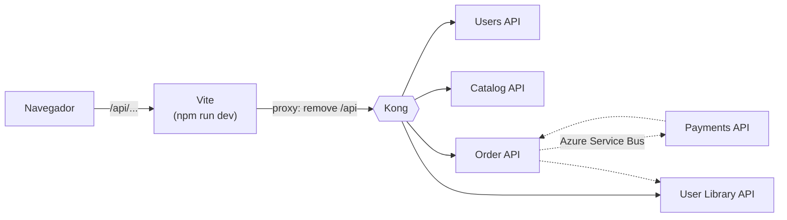

# FIAP Cloud Games — Front-end (`fcg-frontend`)

Cliente web do **FIAP Cloud Games (FCG)**, o ecossistema de microsserviços .NET do Tech Challenge (Pós-Tech FIAP). Ele junta Users, Catalog, Order, Payments e User Library numa única aplicação com cara de loja e biblioteca de jogos, para **testar e visualizar o ecossistema funcionando sem Postman**.

É um cliente de teste com aparência de produto, não uma loja real. O foco acadêmico continua no back-end; o front serve para exercitar as rotas do Kong e deixar visível o que o Postman esconde: a compra assíncrona, os limites do gateway (HTTP 429) e os perfis Player e Admin.

> **Todas as chamadas passam pelo Kong.** O front nunca fala direto com um microsserviço.

---

## Sumário

- [Escopo](#escopo)
- [Como funciona](#como-funciona)
- [Pré-requisitos](#pré-requisitos)
- [Como rodar](#como-rodar)
  - [1. Sem back-end (mock)](#1-sem-back-end-mock)
  - [2. Local com Docker Compose](#2-local-com-docker-compose)
  - [3. Kubernetes local](#3-kubernetes-local)
  - [4. Nuvem (AKS) — ambiente de entrega do Tech Challenge](#4-nuvem-aks--ambiente-de-entrega-do-tech-challenge)
- [Comandos](#comandos)
- [Configuração](#configuração)
- [Estrutura do projeto](#estrutura-do-projeto)
- [Decisões de projeto](#decisões-de-projeto)
- [Solução de problemas](#solução-de-problemas)

---

## Escopo

**Objetivo (definido no escopo inicial):** sem Postman, conseguir se cadastrar, entrar, navegar no catálogo com promoções em destaque, comprar um ou mais jogos com pagamento simulado, ver o pedido sair de "processando" para aprovado ou recusado, ver os jogos na biblioteca e, como Admin, gerenciar jogos, promoções e usuários.

### Telas

| Tela | Rota | Rotas do Kong usadas | Estado |
| :--- | :--- | :--- | :--- |
| Catálogo (inicial, pública): promoções em destaque, filtro por gênero, paginação, painel de detalhe, selo "Na biblioteca", média de avaliações | `/` | `/catalog/games`, `/catalog/games/promoted`, `/catalog/games/covers` | Pronta |
| Entrar / Cadastrar | `/entrar` | `/user/sign-in`, `/user/register` | Pronta |
| Minha biblioteca: avaliação de 1 a 5 estrelas, selo "Fora da loja" | `/biblioteca` | `/library`, `PUT /library/{gameId}/rating`, `/catalog/games/covers` | Pronta |
| Minha conta: editar nome e senha, desativar conta | `/conta` | `/my-account` | Pronta |
| Carrinho e pagamento simulado | `/carrinho` | `/user/order` | Próxima etapa |
| Meus pedidos: linha do tempo e histórico | `/pedidos` | `/user/order` | Próxima etapa |
| Admin: jogos, promoções, usuários, manutenção | `/admin` | `/admin/*` | Próxima etapa |

As telas ainda não construídas abrem uma página "Esta tela entra numa próxima etapa da construção do front".

### Fora de escopo

Pagamento real, caixa de entrada de e-mails, deploy do front em produção, SEO, internacionalização, upload de imagens e botão de "forçar recusa" do pagamento.

### O que seria falha mesmo funcionando

- Chamar algum serviço sem passar pelo Kong.
- A tela de pagamento pedir cartão, CPF ou qualquer dado que pareça real.
- Mostrar "comprado!" logo após o `POST`, escondendo que a compra é assíncrona.

---

## Como funciona



- **Proxy do Vite.** O código sempre chama `/api/...`. O servidor do Vite repassa para o Kong tirando o prefixo: `/api/catalog/games` vira `<KONG_URL>/catalog/games`. Isso contorna a falta de CORS no Kong e permite trocar de ambiente (local, cluster, nuvem) mudando só a variável `KONG_URL`.
- **Sessão.** `POST /user/sign-in` devolve o JWT no campo `acessToken` (com um "c" só). O front guarda o token no navegador e o envia como `Authorization: Bearer <token>`. Qualquer `401` limpa a sessão e volta para o login. O nome exibido no cabeçalho vem da claim `unique_name` do token.
- **Perfis.** `Player` compra e tem biblioteca. `Admin` vê o menu Admin e **não compra**: `/user/order` exige a policy `PlayersOnly`.
- **Compra assíncrona.** `POST /user/order` recebe a lista de jogos e devolve `200` sem corpo. O pedido nasce `Draft`; a Payments API aprova ou recusa (cerca de 90% de aprovação simulada) via Azure Service Bus, e o pedido vira `Completed` ou `Cancelled`. O front vai identificar o pedido novo como o `Draft` mais recente e consultar até ele sair desse estado.
- **Capas.** O admin informa a capa como texto: um link externo ou um caminho servido pelo próprio front (`/covers/<arquivo>.svg`, em [`public/covers/`](public/covers/)). Jogo sem capa mostra um placeholder com gradiente e o nome. A biblioteca busca as capas em lote em `/catalog/games/covers`, que também devolve jogos desativados.
- **Avaliações.** No painel de um jogo da biblioteca, o Player dá de 1 a 5 estrelas e salva com `PUT /library/{gameId}/rating` (a User Library aceita de 0 a 5; avaliar de novo troca a nota). A User Library publica o evento e o Catalog recalcula a média, então o catálogo mostra a média e a quantidade (`averageRating`/`ratingCount`) só depois que o evento é consumido, não na hora. Jogo sem avaliações não mostra média.
- **Fora da loja.** Jogo da biblioteca que foi desativado, ou que o Catalog não conhece mais, continua na biblioteca com o selo "Fora da loja": não se compra mais, mas pode ser avaliado. O front sabe disso pelo `isActive` de `/catalog/games/covers`.
- **Erros.** `429` mostra a mensagem do Kong ("Você enviou muitos requests...") e tenta de novo depois; erros de validação aparecem junto aos campos.

---

## Pré-requisitos

- **Node.js `20.19+` ou `22.12+`** (exigência do Vite 8) e npm.
- Para usar as APIs de verdade, um Kong acessível. Ele vem do repositório [`fcg-infrastructure`](https://github.com/alexoliveiraferreiradev/fcg-infrastructure), que sobe todo o back-end via Docker Compose ou Kubernetes.

Instale as dependências uma vez:

```bash
git clone https://github.com/alexoliveiraferreiradev/fcg-front-end.git
cd fcg-front-end
npm install
```

---

## Como rodar

O front roda sempre da mesma forma, com o servidor do Vite na sua máquina. O que muda entre os cenários é **para qual Kong o proxy aponta**:

| Cenário | Back-end | Kong | Comando do front |
| :--- | :--- | :--- | :--- |
| 1. Mock | nenhum | nenhum | `npm run dev:mock` |
| 2. Docker Compose | `fcg-infrastructure` local | `http://localhost:8000` | `npm run dev` |
| 3. Kubernetes local | `fcg-infrastructure` em Docker Desktop, Minikube, Kind ou k3d | `http://localhost:30080` | `KONG_URL=http://localhost:30080 npm run dev` |
| 4. Nuvem (AKS) | cluster do Tech Challenge no Azure | `http://<EXTERNAL-IP>` | `KONG_URL=http://<EXTERNAL-IP> npm run dev` |

Em todos os casos, abra **http://localhost:5173**.

> **Sobre "produção":** o front não tem imagem Docker, manifesto Kubernetes nem deploy próprio. Isso foi decidido no escopo inicial e só muda quando o CORS for configurado no Kong. Para demonstrar o ambiente de produção do Tech Challenge, rode o front localmente apontando para o Kong da nuvem (cenário 4).

### 1. Sem back-end (mock)

Útil para ver as telas sem subir nada. Os dados vêm de [`mock/`](mock/) e aparece uma faixa de aviso no topo.

```bash
npm run dev:mock
```

- Qualquer e-mail e senha entram. E-mail com `admin` entra como Admin.
- A senha `errada` devolve `401`.
- Variáveis opcionais: `MOCK_PROMOS=0..5` (quantidade de promoções), `MOCK_LIBRARY=0..14` (tamanho da biblioteca; `0` testa a biblioteca vazia), `MOCK_LATENCY` (atraso em ms, padrão 350) e `MOCK_RATING_DELAY` (ms até a média do catálogo mudar depois de uma nota, padrão 1500, imitando o Catalog consumindo o evento).
- A biblioteca de exemplo traz jogos já avaliados e jogos fora da loja (um desativado e um que o Catalog não conhece mais).

```bash
MOCK_PROMOS=0 MOCK_LIBRARY=0 npm run dev:mock
```

### 2. Local com Docker Compose

Sobe o ecossistema inteiro (SQL Server, MongoDB, Redis, APIs, migrations e Kong) na sua máquina.

**No repositório `fcg-infrastructure`:**

```bash
git clone https://github.com/alexoliveiraferreiradev/fcg-infrastructure.git
cd fcg-infrastructure
cp .env.example .env
docker compose up -d
```

No Windows (PowerShell), troque o `cp` por `Copy-Item .env.example .env`.

A primeira subida leva alguns minutos: o SQL Server inicializa, as migrations rodam e só então as APIs e o Kong sobem. Acompanhe com:

```bash
docker compose ps
```

Confira que o Kong responde:

```bash
curl http://localhost:8000/catalog/games
```

**No repositório `fcg-front-end`:**

```bash
npm run dev
```

> **Limite de compra no Compose:** `/user/order` e `/library` aceitam **2 requisições por minuto, somando todos os usuários e abas** (todos os tokens caem no mesmo consumer do Kong). Ao comprar ou abrir a biblioteca várias vezes seguidas, espere ver o aviso de limite; o front tenta de novo sozinho.

### 3. Kubernetes local

Com os manifestos de `fcg-infrastructure/k8s/` aplicados num cluster local (passo a passo no README do `fcg-infrastructure`), o Kong fica no NodePort `30080`:

```bash
curl http://localhost:30080/catalog/games
```

No repositório `fcg-front-end`:

```bash
KONG_URL=http://localhost:30080 npm run dev
```

No PowerShell:

```powershell
$env:KONG_URL = "http://localhost:30080"; npm run dev
```

No Minikube, use a URL devolvida por:

```bash
minikube service kong-proxy --url
```

### 4. Nuvem (AKS) — ambiente de entrega do Tech Challenge

No Azure, os microsserviços rodam no AKS e são publicados pelo pipeline de cada API (`.github/workflows/cd.yml`, no namespace `default`). O Kong é exposto pelo Service `kong-proxy`, do tipo `LoadBalancer`, na porta `80`.

**1. Conecte o `kubectl` ao cluster** (use o grupo de recursos e o nome do cluster do ambiente):

```bash
az login
az aks get-credentials --resource-group <grupo-de-recursos> --name <nome-do-cluster>
```

**2. Descubra o IP público do Kong** (coluna `EXTERNAL-IP`):

```bash
kubectl get service kong-proxy
```

**3. Confira que o gateway responde:**

```bash
curl http://<EXTERNAL-IP>/catalog/games
```

**4. Rode o front apontando para ele:**

```bash
KONG_URL=http://<EXTERNAL-IP> npm run dev
```

Para não repetir a variável, crie um arquivo `.env.local` na raiz do `fcg-front-end` (ele não é versionado):

```
KONG_URL=http://<EXTERNAL-IP>
```

e rode só `npm run dev`.

> **Limite de compra no Kubernetes:** diferente do Compose, `/user/order` e `/library` contam **10 requisições por minuto por usuário**. Quem estoura recebe `429` só para si.

---

## Comandos

| Comando | O que faz |
| :--- | :--- |
| `npm install` | Instala as dependências |
| `npm run dev` | Servidor de desenvolvimento em `http://localhost:5173`, com proxy `/api` para o Kong (`KONG_URL`, padrão `http://localhost:8000`) |
| `npm run dev:mock` | Servidor de desenvolvimento com dados de exemplo, sem Kong |
| `npm test` | Testes unitários (Vitest) |
| `npm run lint` | ESLint |
| `npm run build` | Checagem de tipos (`tsc -b`) e build de produção em `dist/` |
| `npm run preview` | Serve o build de `dist/` em `http://localhost:4173`, com o mesmo proxy para o Kong |

---

## Configuração

| Variável | Onde vale | Padrão | Para que serve |
| :--- | :--- | :--- | :--- |
| `KONG_URL` | `npm run dev`, `npm run preview` | `http://localhost:8000` | Endereço do Kong para onde o proxy `/api` encaminha |
| `MOCK_PROMOS` | `npm run dev:mock` | todas | Quantas promoções aparecem (0 a 5) |
| `MOCK_LIBRARY` | `npm run dev:mock` | todos | Quantos jogos há na biblioteca (0 a 14) |
| `MOCK_LATENCY` | `npm run dev:mock` | `350` | Atraso simulado das respostas, em ms |
| `MOCK_RATING_DELAY` | `npm run dev:mock` | `1500` | Tempo, em ms, até a média do catálogo mudar depois de uma nota |

`KONG_URL` pode vir do ambiente do terminal ou de um arquivo `.env.local` na raiz.

---

## Estrutura do projeto

```
src/
  api/          cliente HTTP (prefixo /api, token, 401 e 429) e chamadas por serviço
  auth/         sessão do usuário (token, perfil, logout)
  cart/         carrinho guardado no navegador
  components/   cabeçalho, cards, painel de detalhe, filtro, paginação, avisos, formulários
  lib/          regras puras (JWT, jogo, biblioteca, conta, paginação), com testes *.test.ts
  pages/        Catálogo, Entrar, Minha biblioteca, Minha conta
  styles/       tema (cores e tipografia inspiradas no site da FIAP)
mock/           API de exemplo usada por npm run dev:mock
public/covers/  capas de exemplo em SVG, usadas como /covers/<arquivo>.svg
```

Stack: React 19, TypeScript, Vite 8, React Router, TanStack Query, CSS puro com variáveis e Vitest.

---

## Decisões de projeto

| Decisão | Motivo |
| :--- | :--- |
| React + TypeScript + Vite | Escolha delegada no escopo inicial; o servidor do Vite também resolve o proxy |
| Proxy `/api` no Vite em vez de chamar o Kong direto | O Kong não tem plugin CORS; o proxy evita mexer no gateway e mantém toda chamada passando por ele |
| Sem Dockerfile, Compose ou Kubernetes para o front | Ficam para quando o CORS for configurado no Kong; até lá o front roda com `npm run dev` |
| Avisos ("Cadastro efetuado", "Pedido aprovado", "Pagamento recusado") derivados das respostas das APIs | O front não consegue observar a Notification Function |
| Carrinho com vários jogos, no navegador | `POST /user/order` já aceita uma lista de jogos |
| Capa como link de texto, sem upload | Evita storage e rota nova só para imagens |
| Capas da biblioteca por endpoint em lote no Catalog | Não muda o contrato da User Library, e a capa editada pelo admin aparece na hora |
| Pedido novo identificado como o `Draft` mais recente | `POST /user/order` não devolve o id do pedido |
| Pagamento simulado sem nenhum campo de dado | Nada pode parecer coleta de dado real |
| Avaliação salva por botão, não a cada clique nas estrelas | `PUT /library/...` tem rate limit no Kong; trocar a nota pelo teclado mandaria várias requisições |
| Média do catálogo atualizada só na próxima visita | O Catalog recalcula ao consumir o evento; o front não força um recarregamento que ainda traria a média antiga |

---

## Solução de problemas

| Sintoma | Causa provável | O que fazer |
| :--- | :--- | :--- |
| Telas mostram erro e o terminal do Vite registra `http proxy error` | O Kong não está no ar ou `KONG_URL` aponta para o lugar errado | `curl <KONG_URL>/catalog/games`; no Compose, `docker compose ps` no `fcg-infrastructure` |
| Todas as rotas logadas respondem `401` (Compose) | `JWT_SECRET` do `.env` diferente do que está gravado no `kong.yml` | No `fcg-infrastructure`: `pwsh ./kong/generate-kong-config.ps1` e `docker compose up -d --force-recreate kong` |
| Aviso de limite (`429`) ao comprar ou abrir a biblioteca | Rate limit do Kong (2/min no Compose, 10/min por usuário no Kubernetes) | Aguarde; o front tenta de novo depois |
| Admin não vê o carrinho | Comportamento esperado: `/user/order` só aceita Player | Entre com uma conta Player para comprar |
| Salvar a avaliação falha com `404` ou `405` | A rota da User Library no Kong (`userlibrary-route`) só libera `GET` | Libere `PUT` nessa rota no `fcg-infrastructure` |
| Avaliei, mas a média do catálogo não mudou | O Catalog ainda não consumiu o evento, ou a página do catálogo ainda está em cache | Espere alguns segundos e recarregue o catálogo |
| Cards sem capa, sem preço riscado ou promoção sem botão de carrinho | Catalog numa versão sem `coverUrl`, `originalPrice` público ou `gameId`/`endDate` nas promoções | Atualize o `fcg-catalog-api` |
| `npm run dev` falha ao iniciar | Node.js abaixo da versão exigida pelo Vite 8 | Use Node.js `20.19+` ou `22.12+` |
